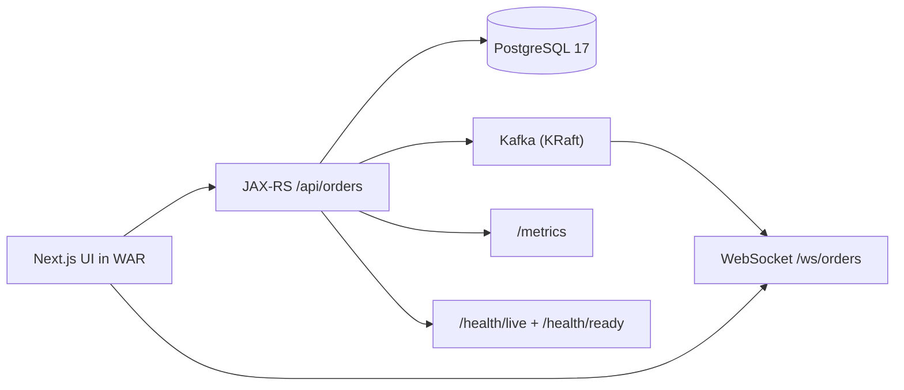

# Orders Service — Open Liberty Platform

Full-stack orders platform based on the Open Liberty lab specs:

- **Backend**: Jakarta EE 10 JAX-RS, MicroProfile Health/Metrics/Config, WebSocket, PostgreSQL, Kafka
- **Frontend**: Next.js 15 + React 19 + Tailwind CSS (static export bundled into the WAR)
- **Runtime**: WebSphere Open Liberty (latest) on Java 17
- **Infrastructure**: PostgreSQL 17, Apache Kafka (KRaft, latest), Kubernetes blue/green manifests

## Architecture



## Project layout

```
om-liberty/
├── orders-service/     # Maven WAR (JAX-RS + bundled frontend)
├── frontend/           # Next.js + Tailwind + WebSocket client
├── liberty/            # server.xml, Dockerfile
├── k8s/                # Blue/green Kubernetes manifests (static reference)
│   └── kafka/          # KRaft broker + topic provisioning Job
├── kafka/              # Topic config and create-topics.sh
├── ansible/            # Ansible playbooks to deploy/manage K8s
├── docker-compose.yml  # Local stack (PG + Kafka + Liberty)
└── scripts/
    ├── build.sh        # Build WAR + Docker image (local)
    ├── deploy-k8s.sh   # Full build + deploy to Kubernetes
    └── ansible-k8s.sh  # Kubernetes rollout/status helper
```

## Quick start (local)

### Prerequisites

- Java 17+
- Maven 3.9+
- Docker & Docker Compose

### Build and run

```bash
chmod +x scripts/build.sh
./scripts/build.sh
docker compose up
```

Open http://localhost:9080 for the UI.

Kafka runs in **KRaft mode** (no ZooKeeper). Topics are created by the `kafka-init` service before the app starts. See [kafka/README.md](kafka/README.md).

### API endpoints

| Endpoint | Description |
|----------|-------------|
| `GET /` | Next.js dashboard (static) |
| `GET /api/orders` | List orders (JWT / dev auth) |
| `POST /api/orders` | Create order |
| `PATCH /api/orders/{id}/fulfill` | Mark pending order as fulfilled |
| `DELETE /api/orders/{id}` | Delete pending order |
| `GET /api/orders/version` | Service version |
| `WS /ws/orders` | Live Kafka event stream |
| `GET /health/live` | Liveness probe |
| `GET /health/ready` | Readiness (PG + Kafka) |
| `GET /metrics` | Prometheus metrics |

### Dev auth

Local mode sets `orders.security.enabled=false`. A dev `SecurityContext` grants `orders.read` and `orders.write` roles without JWT.

For hardened mode, use `liberty/server-hardened.xml` with TLS + MicroProfile JWT (see `skills-1.md`).

## Build WAR only

```bash
mvn -f orders-service/pom.xml clean package
```

The WAR at `orders-service/target/orders-service.war` contains:

- JAX-RS API at `/api/*`
- WebSocket at `/ws/orders`
- Next.js static export at `/`

## Docker images (v1 / v2)

```bash
# v1 (blue)
docker build -f liberty/Dockerfile \
  --build-arg SERVER_CONFIG=server.xml \
  -t my-registry/orders-service:1.0.0 liberty/

# v2 (green) — hardened config, version=v2
cp liberty/server-hardened.xml liberty/server.xml
docker build -f liberty/Dockerfile \
  -t my-registry/orders-service:2.0.0 liberty/
```

## Full Kubernetes deploy (build + deploy everything)

One script builds frontend + backend, creates the Liberty Docker image, and deploys the full stack to Kubernetes (PostgreSQL, Kafka/KRaft + topics, orders-service blue/green, Ingress, ServiceMonitor):

```bash
chmod +x scripts/deploy-k8s.sh
./scripts/deploy-k8s.sh
```

### What it does

1. **Build** — `mvn package` (Next.js static export + JAX-RS WAR)
2. **Image** — Docker build for `orders-service` (Liberty)
3. **Push/load** — Pushes to registry, or loads into kind/minikube
4. **Deploy** — Ansible provisions namespace, PostgreSQL, Kafka, topics, blue/green deployments, service, ingress
5. **Verify** — Waits for rollout and checks `/health/ready`

### Common options

```bash
# Production registry + inventory
IMAGE_REGISTRY=ghcr.io/myorg \
IMAGE_TAG_BLUE=1.0.0 \
INVENTORY=inventory/production/hosts.yml \
./scripts/deploy-k8s.sh

# Kind cluster (no registry push)
CLUSTER_TYPE=kind KIND_CLUSTER_NAME=kind ./scripts/deploy-k8s.sh

# Minikube (uses minikube docker-env)
CLUSTER_TYPE=minikube ./scripts/deploy-k8s.sh

# Also build green/hardened v2 image
BUILD_GREEN=true IMAGE_TAG_GREEN=2.0.0 ./scripts/deploy-k8s.sh

# Deploy only (skip build)
SKIP_BUILD=true ./scripts/deploy-k8s.sh
```

| Variable | Default | Description |
|----------|---------|-------------|
| `IMAGE_REGISTRY` | `my-registry` | Container registry |
| `IMAGE_TAG_BLUE` | `1.0.0` | Blue deployment tag |
| `IMAGE_TAG_GREEN` | `2.0.0` | Green deployment tag |
| `CLUSTER_TYPE` | `remote` | `remote`, `kind`, or `minikube` |
| `INVENTORY` | `inventory/dev/hosts.yml` | Ansible inventory |
| `BUILD_GREEN` | `false` | Also build hardened v2 image |
| `SKIP_BUILD` | `false` | Skip Maven + Docker build |
| `SKIP_DEPLOY` | `false` | Skip Kubernetes deploy |

## Kubernetes blue/green rollout

### Option A — Ansible (recommended)

```bash
chmod +x scripts/ansible-k8s.sh
ansible-galaxy collection install -r ansible/requirements.yml

./scripts/ansible-k8s.sh deploy    # deploy full stack
./scripts/ansible-k8s.sh status    # check health
./scripts/ansible-k8s.sh rollout   # switch traffic blue → green
./scripts/ansible-k8s.sh rollback  # switch traffic back to blue
```

Production:

```bash
INVENTORY=inventory/production/hosts.yml ./scripts/ansible-k8s.sh deploy
```

See [ansible/README.md](ansible/README.md) for variables, inventories, and playbook details.

### Option B — kubectl (manual)

```bash
kubectl apply -f k8s/namespace.yaml
kubectl apply -f k8s/postgres/
kubectl apply -f k8s/kafka/
kubectl apply -f k8s/orders-blue.yaml
kubectl apply -f k8s/orders-green.yaml
kubectl apply -f k8s/orders-service.yaml
kubectl apply -f k8s/orders-ingress.yaml
kubectl apply -f k8s/orders-servicemonitor.yaml
```

Switch traffic blue → green by updating the Service selector in `k8s/orders-service.yaml`:

```yaml
selector:
  app: orders-service
  color: green   # was blue
```

## Observability

Prometheus scrapes `/metrics` via the ServiceMonitor. Useful Grafana queries:

```promql
sum(rate(http_server_requests_seconds_count[5m]))
histogram_quantile(0.95, sum(rate(http_server_requests_seconds_bucket[5m])) by (le))
```

Filter by `version` and `color` tags from `MP_METRICS_TAGS`.

## References

- [docs/END_TO_END_USER_GUIDE.md](docs/END_TO_END_USER_GUIDE.md) — Full end-to-end technical user guide (architecture, API, K8s, troubleshooting)
- `skills.md` — Liberty deployment, health/metrics, blue/green K8s
- `skills-1.md` — TLS, JWT, security headers hardening
