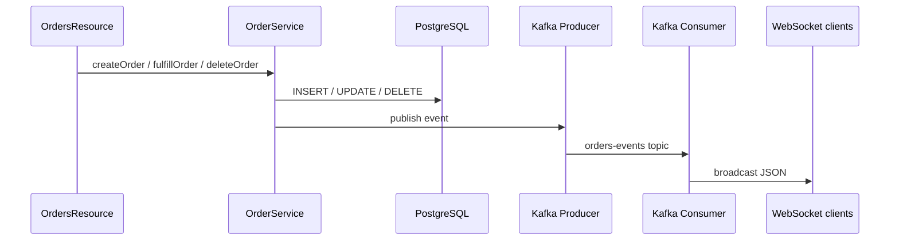

# Orders Service — End-to-End Technical User Guide

This guide walks through the full orders platform: architecture, local development, using the application, API reference, Kubernetes deployment, blue/green rollout, configuration, observability, and troubleshooting.

---

## Table of contents

1. [What this platform does](#1-what-this-platform-does)
2. [Architecture](#2-architecture)
3. [Prerequisites](#3-prerequisites)
4. [Project structure](#4-project-structure)
5. [Local development (Docker Compose)](#5-local-development-docker-compose)
6. [Using the application](#6-using-the-application)
7. [Order lifecycle](#7-order-lifecycle)
8. [REST API reference](#8-rest-api-reference)
9. [WebSocket and Kafka events](#9-websocket-and-kafka-events)
10. [Configuration](#10-configuration)
11. [Kubernetes deployment](#11-kubernetes-deployment)
12. [Blue/green rollout](#12-bluegreen-rollout)
13. [Observability](#13-observability)
14. [Troubleshooting](#14-troubleshooting)
15. [Quick command reference](#15-quick-command-reference)

---

## 1. What this platform does

The Orders Service is a full-stack demo/production-style platform that:

- Serves a **Next.js dashboard** and **JAX-RS API** from a single Open Liberty WAR
- Persists orders in **PostgreSQL 17**
- Publishes order events to **Apache Kafka (KRaft)**
- Streams live events to the browser via **WebSocket**
- Exposes **MicroProfile Health** and **Metrics** for Kubernetes and Prometheus
- Supports **blue/green deployments** on Kubernetes via Ansible

Typical user flows:

| Flow | What happens |
|------|----------------|
| Create order | Saved to PostgreSQL as `PENDING`, event published to Kafka, UI updates |
| Complete order | Status changes to `FULFILLED`, Kafka event broadcast |
| Delete order | Row removed from PostgreSQL (pending only), Kafka event broadcast |
| List orders | Read from PostgreSQL via REST API |

---

## 2. Architecture

```mermaid
flowchart TB
    subgraph Browser
        UI[Next.js UI at /]
        WSClient[WebSocket client]
    end

    subgraph Liberty["Open Liberty (root.war)"]
        API[JAX-RS /api/*]
        WSEndpoint[WebSocket /ws/orders]
        Health[/health/live + /health/ready]
        Metrics[/metrics]
    end

    subgraph Data
        PG[(PostgreSQL 17)]
        KF[Kafka KRaft topic: orders-events]
    end

    UI --> API
    UI --> WSClient
    WSClient --> WSEndpoint
    API --> PG
    API --> KF
    KF --> WSEndpoint
    Health --> PG
    Health --> KF
```

### Request path: create order

1. Browser submits the form → `POST /api/orders`
2. `OrderService` calculates total (`unitPrice × quantity`) and inserts into PostgreSQL with status `PENDING`
3. `OrderEventMessaging` publishes `ORDER_CREATED` to Kafka topic `orders-events`
4. Kafka consumer in the same Liberty instance reads the event and broadcasts it on `/ws/orders`
5. Dashboard WebSocket client receives the event and refreshes the order list

### Runtime stack

| Layer | Technology |
|-------|------------|
| Frontend | Next.js 15, React 19, Tailwind CSS (static export) |
| Backend | Jakarta RESTful WS 3.1, CDI, WebSocket 2.1 |
| Platform | MicroProfile Health 4.0, Metrics 5.0, Config 3.0 |
| Runtime | Open Liberty (Java 17) |
| Database | PostgreSQL 17 |
| Messaging | Apache Kafka latest (KRaft, no ZooKeeper) |
| Orchestration | Kubernetes + Ansible |

---

## 3. Prerequisites

### Local (Docker Compose)

- Java 17+
- Maven 3.9+
- Docker & Docker Compose

### Kubernetes deployment

- Everything above, plus:
- `kubectl` configured for your cluster
- Ansible 2.15+
- `ansible-galaxy collection install -r ansible/requirements.yml`

### Optional

- Ingress controller (e.g. NGINX) for `orders.example.com`
- Prometheus Operator (for ServiceMonitor; skipped automatically if CRD is missing)

---

## 4. Project structure

```
om-liberty/
├── orders-service/          # Maven WAR — JAX-RS, health, metrics, Kafka, PostgreSQL
│   └── src/main/java/com/example/orders/
│       ├── resource/        # REST endpoints (OrdersResource)
│       ├── service/         # Business logic (OrderService)
│       ├── repository/      # JDBC / PostgreSQL (OrderRepository)
│       ├── messaging/       # Kafka producer + consumer (OrderEventMessaging)
│       ├── websocket/       # WebSocket endpoint (/ws/orders)
│       ├── health/          # Readiness check (PG + Kafka)
│       └── config/          # OrdersConfig (env + MP Config)
├── frontend/                # Next.js app (bundled into WAR at build time)
├── liberty/                 # server.xml, server-hardened.xml
├── Dockerfile               # Multi-stage: Maven build → Open Liberty image
├── docker-compose.yml       # Local PG + Kafka + app
├── kafka/                   # Topic definitions and provisioning script
├── k8s/                     # Static Kubernetes manifests (reference)
├── ansible/                 # Deploy, rollout, rollback, status, teardown
├── scripts/
│   ├── deploy-k8s.sh        # Full build + K8s deploy (recommended)
│   ├── ansible-k8s.sh       # Ansible playbook wrapper
│   └── build.sh             # Local WAR + Docker build
└── docs/
    └── END_TO_END_USER_GUIDE.md   # This document
```

---

## 5. Local development (Docker Compose)

### Start the full stack

```bash
# Build WAR and Docker image, then start all services
chmod +x scripts/build.sh
./scripts/build.sh
docker compose up
```

Or build manually:

```bash
mvn -f orders-service/pom.xml clean package -DskipTests
docker compose up --build
```

### Services started

| Service | Port | Purpose |
|---------|------|---------|
| `orders-service` | 9080 | Liberty app (UI + API + WebSocket) |
| `postgres` | 5432 | PostgreSQL database |
| `kafka` | 9094 (host) | Kafka broker (internal: `kafka:9092`) |
| `kafka-init` | — | One-shot job: creates `orders-events` topic |

Kafka runs in **KRaft mode** (no ZooKeeper). Topics are defined in `kafka/topics.list` and provisioned by `kafka/scripts/create-topics.sh`.

### Open the UI

```
http://localhost:9080
```

### Verify health

```bash
curl http://localhost:9080/health/ready
curl http://localhost:9080/api/orders/version
```

Expected readiness response when PostgreSQL and Kafka are up:

```json
{"status":"UP","checks":[{"name":"orders-service-ready","status":"UP"}]}
```

### Stop

```bash
docker compose down        # keep volumes
docker compose down -v     # remove data volumes
```

---

## 6. Using the application

### Dashboard overview

The UI at `/` shows:

- **Order list** — all orders from PostgreSQL, newest first
- **Create Order form** — customer, product, quantity, unit price
- **WebSocket status** — connection state to `/ws/orders`
- **Live Kafka Events** — last 8 events received over WebSocket
- **Service version** — e.g. `v1` (from `ORDERS_SERVICE_VERSION`)

### Create an order

1. Open `http://localhost:9080` (or your ingress URL)
2. Fill in **Customer**, **Product**, **Quantity**, **Unit Price**
3. Click **Create Order**
4. The new row appears in the table with status **PENDING** (blue badge)
5. A Kafka event appears in the **Live Kafka Events** panel

Total amount is computed server-side: `unitPrice × quantity`.

### Complete an order (fulfill)

1. Find a row with status **PENDING**
2. Click **Complete**
3. Status changes to **FULFILLED** (green badge)
4. Action buttons disappear (only pending orders can be completed)

### Delete an order

1. Find a row with status **PENDING**
2. Click **Delete**
3. Confirm the dialog
4. The order is removed from the table

> **Note:** Fulfilled orders cannot be deleted or re-opened. Only `PENDING` orders support Complete and Delete.

### Development authentication

With `orders.security.enabled=false` (default in `server.xml`), a dev security filter grants `orders.read` and `orders.write` roles automatically. No JWT is required locally.

For production hardening, use `liberty/server-hardened.xml` with TLS and MicroProfile JWT (`skills-1.md`).

---

## 7. Order lifecycle

```
                    ┌─────────────┐
                    │   PENDING   │  ← default on create
                    └──────┬──────┘
                           │
              ┌────────────┼────────────┐
              │ Complete   │   Delete   │
              ▼            │            ▼
       ┌─────────────┐     │     (removed from DB)
       │  FULFILLED  │     │
       └─────────────┘     │
                           │
                    (no further actions)
```

| Status | Meaning | Allowed actions |
|--------|---------|-----------------|
| `PENDING` | Order created, awaiting fulfillment | Complete, Delete |
| `FULFILLED` | Order completed | None (read-only) |

Database schema (auto-created on startup):

```sql
CREATE TABLE orders (
    id BIGSERIAL PRIMARY KEY,
    customer_name VARCHAR(255) NOT NULL,
    product VARCHAR(255) NOT NULL,
    quantity INT NOT NULL,
    total_amount NUMERIC(12, 2) NOT NULL,
    status VARCHAR(50) NOT NULL DEFAULT 'PENDING',
    created_at TIMESTAMPTZ NOT NULL DEFAULT NOW()
);
```

---

## 8. REST API reference

Base path: `/api` (JAX-RS `@ApplicationPath("/api")` + `@Path("/orders")`)

All JSON endpoints return `Content-Type: application/json`.

### `GET /api/orders`

List all orders.

**Response 200:**

```json
{
  "user": "dev-user",
  "version": "v1",
  "orders": [
    {
      "id": 1,
      "customerName": "Acme Corp",
      "product": "Widget",
      "quantity": 2,
      "totalAmount": 20.00,
      "status": "PENDING",
      "createdAt": "2026-06-18T18:21:45.962784Z"
    }
  ]
}
```

### `POST /api/orders`

Create a new order.

**Request body:**

```json
{
  "customerName": "Acme Corp",
  "product": "Widget Pro",
  "quantity": 2,
  "unitPrice": 10.00
}
```

| Field | Required | Notes |
|-------|----------|-------|
| `customerName` | Yes | |
| `product` | Yes | |
| `quantity` | Yes | Must be > 0 |
| `unitPrice` | No | Defaults to `10.00` if omitted |

**Response 201:** Created order object.

**Response 400:** Missing or invalid fields.

**Example:**

```bash
curl -X POST http://localhost:9080/api/orders \
  -H "Content-Type: application/json" \
  -d '{"customerName":"Acme","product":"Widget","quantity":1,"unitPrice":9.99}'
```

### `PATCH /api/orders/{id}/fulfill`

Mark a pending order as fulfilled.

**Response 200:** Updated order with `"status": "FULFILLED"`.

**Response 404:** Order not found.

**Response 409:** Order is not `PENDING`.

```bash
curl -X PATCH http://localhost:9080/api/orders/1/fulfill
```

### `DELETE /api/orders/{id}`

Delete a pending order.

**Response 204:** No content.

**Response 404:** Order not found.

**Response 409:** Order is not `PENDING`.

```bash
curl -X DELETE http://localhost:9080/api/orders/1
```

### `GET /api/orders/version`

Service version (no auth required).

**Response 200:**

```json
{"version": "v1"}
```

### Health and metrics

| Endpoint | Purpose |
|----------|---------|
| `GET /health/live` | Liveness — process is running |
| `GET /health/ready` | Readiness — PostgreSQL + Kafka reachable |
| `GET /metrics` | Prometheus scrape endpoint |

---

## 9. WebSocket and Kafka events

### WebSocket

- **URL:** `ws://<host>/ws/orders` (or `wss://` over TLS)
- **Purpose:** Real-time order event stream to the browser
- On connect, the server registers the session; Kafka consumer broadcasts each message to all connected clients

### Kafka topic

| Property | Value |
|----------|-------|
| Topic | `orders-events` |
| Partitions | 3 |
| Replication | 1 (dev) |
| Mode | KRaft (no ZooKeeper) |

### Event payloads

Events are JSON strings published to Kafka and forwarded unchanged to WebSocket clients:

**ORDER_CREATED**

```json
{"event":"ORDER_CREATED","id":1,"customer":"Acme","product":"Widget","quantity":2,"status":"PENDING"}
```

**ORDER_FULFILLED**

```json
{"event":"ORDER_FULFILLED","id":1,"customer":"Acme","product":"Widget","quantity":2,"status":"FULFILLED"}
```

**ORDER_DELETED**

```json
{"event":"ORDER_DELETED","id":1,"customer":"Acme","product":"Widget","quantity":2,"status":"PENDING"}
```

### Event flow



---

## 10. Configuration

Configuration is resolved in this order (first match wins):

1. MicroProfile Config property (`orders.*` in `server.xml` or `microprofile-config.properties`)
2. Environment variable (`ORDERS_*`)
3. Built-in default in `OrdersConfig.java`

### Application settings

| Property / Env | Default | Description |
|----------------|---------|-------------|
| `orders.db.url` / `ORDERS_DB_URL` | `jdbc:postgresql://postgres:5432/orders` | JDBC URL |
| `orders.db.user` / `ORDERS_DB_USER` | `orders` | DB user |
| `orders.db.password` / `ORDERS_DB_PASSWORD` | `orders` | DB password |
| `orders.kafka.bootstrap.servers` / `ORDERS_KAFKA_BOOTSTRAP_SERVERS` | `kafka:9092` | Kafka brokers |
| `orders.kafka.topic` / `ORDERS_KAFKA_TOPIC` | `orders-events` | Event topic |
| `orders.service.version` / `ORDERS_SERVICE_VERSION` | `v1` | Shown in UI and API |
| `orders.security.enabled` / `ORDERS_SECURITY_ENABLED` | `false` | Enable JWT auth |
| `MP_METRICS_TAGS` | — | Prometheus labels (e.g. `version=v1,color=blue`) |

### Liberty server profiles

| File | Use case |
|------|----------|
| `liberty/server.xml` | Development — HTTP 9080, security off, version v1 |
| `liberty/server-hardened.xml` | Production — HTTPS 9443, JWT, security headers, version v2 |

Select at Docker build time:

```bash
docker build --build-arg SERVER_CONFIG=server.xml -t my-registry/orders-service:latest .
docker build --build-arg SERVER_CONFIG=server-hardened.xml -t my-registry/orders-service:2.0.0 .
```

---

## 11. Kubernetes deployment

### One-command deploy (recommended)

```bash
chmod +x scripts/deploy-k8s.sh
./scripts/deploy-k8s.sh
```

This script:

1. Builds the WAR (Maven + Next.js)
2. Builds the Liberty Docker image
3. Pushes or loads the image (depending on cluster type)
4. Runs Ansible `deploy.yml` to provision:
   - Namespace `orders`
   - PostgreSQL 17 (PVC + Deployment + Service)
   - Kafka KRaft broker + topic init Job
   - `orders-blue` and `orders-green` Deployments
   - `orders-service` ClusterIP Service
   - Ingress (`orders.example.com`)
   - ServiceMonitor (if Prometheus CRD exists)
5. Verifies rollout and `/health/ready`

### Environment variables for `deploy-k8s.sh`

| Variable | Default | Description |
|----------|---------|-------------|
| `IMAGE_REGISTRY` | `my-registry` | Container registry |
| `IMAGE_NAME` | `orders-service` | Image name |
| `IMAGE_TAG_BLUE` | `latest` | Blue image tag |
| `IMAGE_TAG_GREEN` | `latest-green` | Green image tag |
| `CLUSTER_TYPE` | `remote` | `remote`, `kind`, or `minikube` |
| `INVENTORY` | `inventory/dev/hosts.yml` | Ansible inventory |
| `ORDERS_NAMESPACE` | `orders` | K8s namespace |
| `BUILD_GREEN` | `false` | Also build hardened green image |
| `SKIP_BUILD` | `false` | Skip Maven + Docker build |
| `SKIP_DEPLOY` | `false` | Skip Ansible deploy |
| `KUBECONFIG` | `~/.kube/config` | Cluster credentials |

**Examples:**

```bash
# Docker Desktop (uses local images automatically)
./scripts/deploy-k8s.sh

# Kind cluster
CLUSTER_TYPE=kind KIND_CLUSTER_NAME=kind ./scripts/deploy-k8s.sh

# Production registry
IMAGE_REGISTRY=ghcr.io/myorg \
IMAGE_TAG_BLUE=1.0.0 \
INVENTORY=inventory/production/hosts.yml \
./scripts/deploy-k8s.sh

# Deploy only (image already built)
SKIP_BUILD=true ./scripts/deploy-k8s.sh
```

### Access the app on Kubernetes

**Port-forward (quickest for dev):**

```bash
kubectl -n orders port-forward deployment/orders-blue 9080:9080
```

Then open `http://localhost:9080`.

**Via Ingress:**

Add to `/etc/hosts`:

```
127.0.0.1 orders.example.com
```

Port-forward ingress controller or configure DNS to your cluster LB, then open `http://orders.example.com`.

### Check deployment status

```bash
kubectl -n orders get pods,svc,ingress
./scripts/ansible-k8s.sh status
```

Expected pods (all Running or Completed):

- `postgres-*`
- `kafka-*`
- `kafka-init-topics-*` (Completed)
- `orders-blue-*`
- `orders-green-*`

### Teardown

```bash
./scripts/ansible-k8s.sh teardown
```

---

## 12. Blue/green rollout

The platform runs two deployments (`orders-blue`, `orders-green`). The `orders-service` Service selector determines which color receives traffic.

### Initial state

- Both deployments are running
- Service selector points to `color: blue` (configurable via `orders_active_color`)

### Rollout procedure

```bash
# 1. Deploy both colors
./scripts/ansible-k8s.sh deploy

# 2. Verify green is healthy
./scripts/ansible-k8s.sh status
kubectl -n orders port-forward deployment/orders-green 9080:9080
curl http://localhost:9080/health/ready
curl http://localhost:9080/api/orders/version

# 3. Switch traffic to green
./scripts/ansible-k8s.sh rollout

# 4. Roll back if needed
./scripts/ansible-k8s.sh rollback
```

The rollout playbook:

1. Waits for the target Deployment to be ready
2. Patches the Service selector (`color: blue` → `color: green`)

### Build separate v1 / v2 images

```bash
BUILD_GREEN=true \
IMAGE_TAG_BLUE=1.0.0 \
IMAGE_TAG_GREEN=2.0.0 \
./scripts/deploy-k8s.sh
```

Blue uses `server.xml` (v1); green uses `server-hardened.xml` (v2, TLS + JWT).

---

## 13. Observability

### Health probes (Kubernetes)

Deployments configure:

- **Readiness:** `GET /health/ready` (initial delay 45s)
- **Liveness:** `GET /health/live` (initial delay 60s)

Readiness fails when PostgreSQL or Kafka is unreachable.

### Prometheus metrics

Scrape `GET /metrics` on port 9080. A ServiceMonitor is deployed when the Prometheus Operator CRD is present.

Useful queries:

```promql
# Request rate
sum(rate(http_server_requests_seconds_count[5m]))

# p95 latency
histogram_quantile(0.95, sum(rate(http_server_requests_seconds_bucket[5m])) by (le))

# Order operations
orders_create_total
orders_fulfill_total
orders_delete_total
```

Filter by deployment using `MP_METRICS_TAGS` (e.g. `version=v1,color=blue`).

### Logs

Liberty logs JSON to stdout. In Kubernetes:

```bash
kubectl -n orders logs -f deployment/orders-blue
```

---

## 14. Troubleshooting

### UI loads but API returns 404 / Context Root Not Found

- API must be at `/api/orders`, not `/orders-service/api/orders`
- Ensure the WAR is deployed as `root.war` with `contextRoot="/"` in `server.xml`
- After rebuilding the image, restart pods so they pull the new image:

  ```bash
  kubectl -n orders rollout restart deployment/orders-blue deployment/orders-green
  ```

### `Failed to create order: 500`

Common causes:

| Symptom | Cause | Fix |
|---------|-------|-----|
| `NoClassDefFoundError: kafka...Utils` | SLF4J not bundled in WAR | Ensure `slf4j-api` + `slf4j-jdk14` are in `pom.xml` (compile scope) |
| `Failed to insert order` | PostgreSQL unreachable | Check `ORDERS_DB_URL`, postgres pod, credentials |
| Order saved but 500 returned | Kafka publish threw before fix | Rebuild with resilient `publishOrderCreated` (catches errors) |

Check logs:

```bash
kubectl -n orders logs deployment/orders-blue --tail=100
```

### Readiness probe DOWN

```bash
curl http://localhost:9080/health/ready
```

Readiness checks both PostgreSQL (`repository.isDatabaseReachable`) and Kafka (`messaging.isKafkaReachable`). Verify:

```bash
kubectl -n orders get pods
kubectl -n orders logs deployment/kafka --tail=50
```

### Kafka pod CrashLoopBackOff

- KRaft config must use correct `KAFKA_CONTROLLER_QUORUM_VOTERS`
- Ensure topic init Job completed: `kubectl -n orders get jobs`

### WebSocket shows disconnected

- Confirm app is reachable at `/`
- Check browser dev tools → Network → WS for `/ws/orders`
- Kafka consumer must be running (same pod logs)

### Complete/Delete returns 409

Order is not `PENDING` (already fulfilled). Only pending orders can be completed or deleted.

### Ansible deploy fails on `ansible_date_time`

The deploy playbook uses `gather_facts: false`. Timestamp annotations use `lookup('pipe', 'date +%s')` instead.

### Docker Desktop: stale `latest` image

Set `orders_image_pull_policy: Always` in Ansible inventory, or use unique image tags per deploy.

---

## 15. Quick command reference

### Local

```bash
./scripts/build.sh && docker compose up     # Start local stack
curl http://localhost:9080/health/ready     # Health check
curl http://localhost:9080/api/orders       # List orders
docker compose down -v                      # Stop and wipe data
```

### Build only

```bash
mvn -f orders-service/pom.xml clean package -DskipTests
docker build -t my-registry/orders-service:latest .
```

### Kubernetes

```bash
./scripts/deploy-k8s.sh                           # Full build + deploy
./scripts/ansible-k8s.sh status                 # Deployment status
./scripts/ansible-k8s.sh rollout                # Blue → green
./scripts/ansible-k8s.sh rollback               # Green → blue
./scripts/ansible-k8s.sh teardown                 # Remove stack
kubectl -n orders port-forward deployment/orders-blue 9080:9080
```

### API smoke test

```bash
BASE=http://localhost:9080

curl -s $BASE/api/orders/version
curl -s -X POST $BASE/api/orders \
  -H "Content-Type: application/json" \
  -d '{"customerName":"Test","product":"Widget","quantity":1,"unitPrice":10}'
curl -s -X PATCH $BASE/api/orders/1/fulfill
curl -s $BASE/api/orders
curl -s -X DELETE $BASE/api/orders/2
```

---

## Related documentation

- [README.md](../README.md) — Project overview and quick start
- [ansible/README.md](../ansible/README.md) — Ansible variables and playbooks
- [kafka/README.md](../kafka/README.md) — Kafka topic configuration
- `skills.md` — Liberty deployment patterns
- `skills-1.md` — TLS and JWT hardening
